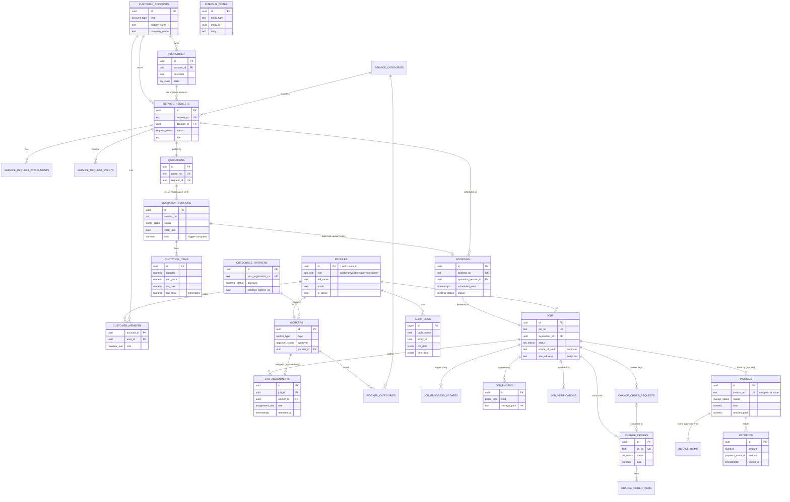

# 2. Entity relationship diagram

## Integrity features worth noting
- **Composite FKs** `(child_id, account_id) → parent(id, account_id)` on requests, quotations, bookings, jobs, change orders, invoices, payments, attachments: cross-account links are impossible.
- **Partial unique indexes** encode business rules: one draft / one live offer / one approved version per quotation; one live booking per request; one live invoice per job; one active lead per job; one active assignment per worker per job.
- **Generated columns** for line totals and line tax (no rounding drift between quotation → invoice).
- `doc_counters` (numbering) and `audit_logs` are not shown; neither is reachable by clients except admin read of audit.
